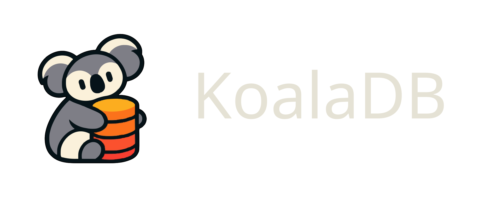
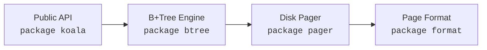
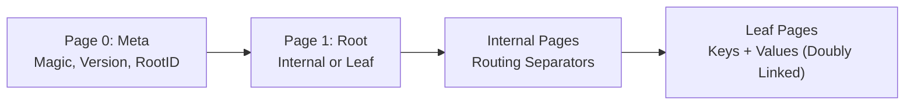

KoalaDB is an embedded key-value storage library written in Go. It implements an on-disk B+Tree to store ordered key-value pairs across fixed 4096-byte pages in a single file.

---

## Overview

KoalaDB operates as an in-process storage engine without external servers, configuration files, or daemon processes. Applications import the package directly to perform persistent key-value operations.



### Key Characteristics

- **Single-File Storage**: All data, routing metadata, and indices reside in a single `.db` file.
- **Logarithmic Point Queries**: Point lookups execute in $O(\log_B N)$ page reads, where $B$ is the node fanout.
- **Ordered Range Scans**: Leaf nodes maintain bidirectional sibling links (`PrevPageID` and `NextPageID`), enabling linear scans without re-traversing internal nodes.
- **In-Place Updates**: Existing keys are updated in-place within target leaf pages.
- **Concurrency Model**: Reader-writer synchronization (`sync.RWMutex`) provides concurrent readers and exclusive single-writer serialization.
- **Standard Library Only**: Built using Go standard library packages (`os`, `sync`, `encoding/binary`).

---

## Quickstart

### Installation

```bash
go get github.com/sarthak-shubham/koala
```

### Usage Example

```go
package main

import (
	"fmt"
	"log"

	"github.com/sarthak-shubham/koala"
)

func main() {
	db, err := koala.Open("data.db")
	if err != nil {
		log.Fatalf("open: %v", err)
	}
	defer db.Close()

	if err := db.Put([]byte("user:001"), []byte("Alice")); err != nil {
		log.Fatalf("put: %v", err)
	}

	val, err := db.Get([]byte("user:001"))
	if err != nil {
		log.Fatalf("get: %v", err)
	}
	fmt.Printf("user:001 = %s\n", string(val))

	it, err := db.Scan([]byte("user:000"), []byte("user:999"))
	if err != nil {
		log.Fatalf("scan: %v", err)
	}
	defer it.Close()

	for it.Next() {
		fmt.Printf("%s: %s\n", string(it.Key()), string(it.Value()))
	}
}
```

---

## Architecture & Storage Layout

The database file is divided into uniform 4096-byte blocks. Any page in the file is addressed by an integer page ID (`offset = pageID * 4096`).



- **Page 0 (Meta Page)**: Contains the 4-byte magic number `0x4B4C4442` (`KLDB`), format version, page size, root page ID, and total allocated page count.
- **Internal Pages**: Store routing separator keys and 8-byte child page IDs. They contain no user values.
- **Leaf Pages**: Store sorted user keys and values, plus 8-byte sibling pointers (`PrevPageID`, `NextPageID`).

---

## Complexity & Back-of-the-Envelope Estimates

With 4096-byte pages and typical 16-byte keys, an internal node branches ~150 ways (fanout $B \approx 150$), while a leaf page holds ~45 entries. Because the tree is wide and flat, height remains small even for large key sets:

| Tree Depth | Key Capacity | Approx. File Size | Disk Reads / Point Query |
| :--- | :--- | :--- | :--- |
| **Level 1 (Leaf Root)** | $\le 45$ keys | 8 KB | 1 |
| **Level 2 (Root + Leaves)** | ~5,000 keys | ~500 KB | 2 |
| **Level 3 (Root + Internal + Leaves)** | ~500,000 keys | ~50 MB | 3 |
| **Level 4 (Root + 2 Internal + Leaves)** | ~50,000,000 keys | ~5 GB | 4 |

> **Note:** These figures are theoretical back-of-the-envelope estimates derived from standard 4096-byte page boundaries and uniform 16-byte keys. Actual capacity in production depends on key and value size variance and runtime page fill factors (typically 60%–70% in dynamic B+Trees).

### Operation Complexity

| Operation | Time | Disk I/O | Behavior |
| :--- | :---: | :---: | :--- |
| **`Get(key)`** | $O(\log N)$ | $O(\log_B N)$ | Binary search down root-to-leaf path |
| **`Put(key, val)`** | $O(\log N)$ | $O(\log_B N)$ | In-place update or leaf split with ancestor propagation |
| **`Scan(start, end)`** | $O(\log N + K)$ | $O(\log_B N + K / L)$ | Seek start leaf, then traverse sibling pointers for $K$ items |

---

## Design Decisions

- **B+Tree vs. Log-Structured Merge Tree**:
  B+Trees provide deterministic read latency and sequential range iteration across leaf pages without requiring background compaction cycles or tombstone filtering.
- **Key Duplication vs. Promotion during Splits**:
  - When a leaf page splits, the midpoint key is **copied** into the parent as a routing separator and retained in the right leaf to maintain user data access.
  - When an internal page splits, the midpoint separator is **promoted** to the parent and omitted from both resulting child pages.
- **Ancestor Traversal Stack**:
  Point traversal maintains a stack of visited page IDs. When an insertion triggers a page split, parent routing updates propagate upward via the stack without requiring backlink pointers in page headers.
- **Thread Safety**:
  Concurrency is coordinated through `sync.RWMutex`. Point queries and range scans acquire read locks (`RLock`), while modifications acquire exclusive write locks (`Lock`).

---

## Verification & Testing

The test suite validates package boundaries, binary formats, tree invariants, and file persistence:

```bash
go test -v ./...
```

### Correctness Validation (`correctness_test.go`)

- Executes **50,000 randomized operations** (interleaved `Put` and `Get` calls) concurrently against both KoalaDB and an in-memory Go map oracle.
- Validates that returned values, missing key errors (`koala.ErrNotFound`), and updates match the oracle across all operations.
- Sweeps the full key space, closes the database, reopens it from disk via `koala.Open`, and validates on-disk persistence.

---

## Scope & Limitations

KoalaDB v1 implements the core tree algorithms and file paging mechanisms. Known boundaries:

- **Durability across Crashes**: Writes are flushed to disk via `pager.Sync()` on close. However, multi-page split sequences that are interrupted by an ungraceful termination or power loss lack a Write-Ahead Log (WAL) to roll back incomplete transactions.
- **Buffer Pool**: Pages are fetched through the operating system page cache via `ReadAt` and `WriteAt`. An application-level LRU buffer pool is not yet implemented.
- **Page Deletion and Reclaiming**: In-place updates are supported, but node-merging on key deletion and free-list page recycling are deferred to future revisions.
- **Concurrency Granularity**: Operations are synchronized via a coarse database-level read-write lock rather than page-level latch crabbing.

---

## License

MIT License. See [LICENSE](LICENSE) for terms.
